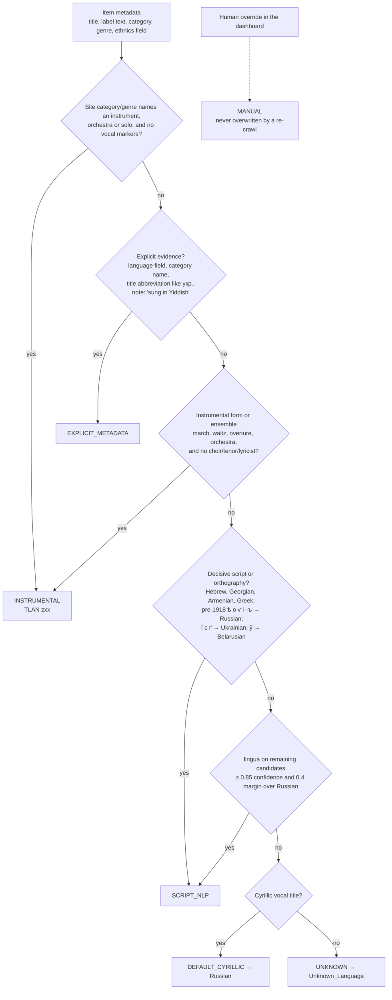
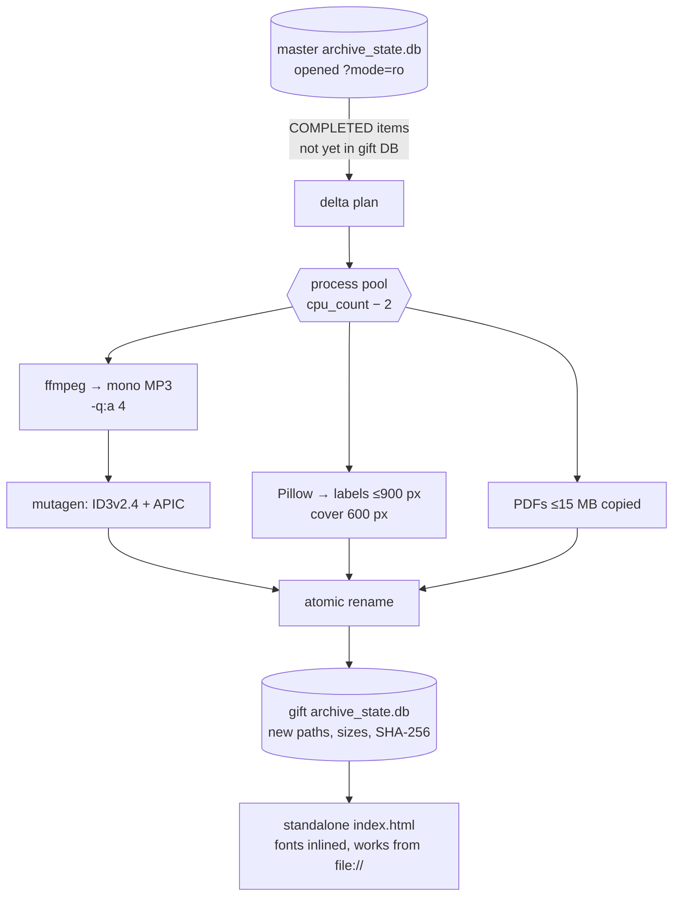
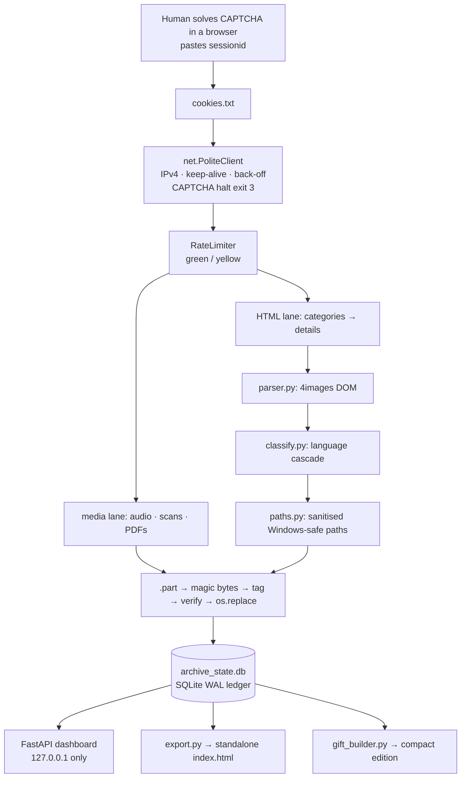

# Building Patefon: Archiving & Streaming Early 20th-Century Gramophone Records with Python, FastAPI, and Adaptive Congestion Control

*An engineering case study in digital preservation.*

Patefon (Russian *патефон*, the wind-up portable gramophone) is a pipeline that preserves a public archive of 78 RPM shellac records from the Russian Empire, the Soviet Union and Central Asia. It turns them into a tagged, searchable local library and plays them back in a small streaming app that runs entirely offline, from a USB stick, with no server.

So far the archive holds **16,500+ recordings in 34 languages**, dating from the 1890s to the 1960s (median year 1930). Most are Russian, followed by Ukrainian, Polish, Italian, German and French. There are also Latvian, Georgian, Yiddish and Armenian records, and Turkic-language ones (Tatar, Uzbek, Kazakh, Azerbaijani, Bashkir) from the Volga, the Caucasus and Central Asia. The source collection is [russian-records.com](https://www.russian-records.com/), a 4images gallery run by a volunteer maintainer. This crawl was carried out with the maintainer's permission. They asked that the method be published so that other fragile collections can be preserved the same way.

> **Try it in 5 seconds:** no cookies, no network.
> ```bash
> python -m venv .venv
> .venv/Scripts/pip install -r requirements.txt    # macOS/Linux: .venv/bin/pip
> python scraper.py --seed-demo
> ```
> Then open `demo_archive/russian_records_archive/index.html` in a browser. You get the full Patefon UI with five synthetic records: sine-tone "recordings" and drawn label art, all generated locally.

---

## Contents

1. [Respectful use](#respectful-use)
2. [The vision](#1-the-vision)
3. [Problem 1: reverse-engineering a legacy 4images gallery](#2-problem-1-reverse-engineering-a-legacy-4images-gallery)
4. [Problem 2: what language is a 1910 shellac disc singing in?](#3-problem-2-what-language-is-a-1910-shellac-disc-singing-in)
5. [Problem 3: crawling fast without breaking a fragile server](#4-problem-3-crawling-fast-without-breaking-a-fragile-server)
6. [Problem 4: shrinking the archive for a USB stick](#5-problem-4-shrinking-the-archive-for-a-usb-stick)
7. [Problem 5: designing Patefon](#6-problem-5-designing-patefon)
8. [Architecture](#7-architecture)
9. [Testing](#8-testing)
10. [Running it](#9-running-it)
11. [Credits & licenses](#credits--licenses)

---

## Respectful use

This repository contains **code only**. No recordings, label scans, PDFs, page caches or credentials are included. The recordings and scans belong to their rights holders and to the archive that digitised them.

The crawler is written for one specific site, and that site is small and run by a volunteer. If you want to archive it, or any other collection:

* **Ask the operator first.** Permission for this project does not extend to anyone else.
* **Keep the defaults.** One request at a time, with a random 2–4 s pause between requests. Parallel mode (`--workers 2..32`) is only for operators who have explicit permission, and it still backs off automatically when the server strains.
* **Never bypass access controls.** The site puts its pages behind a human CAPTCHA. This code contains no CAPTCHA-solving or OCR. A person solves the CAPTCHA in their own browser and pastes the session cookie. The moment the server asks for verification again, the crawler halts (exit code 3) with its state saved.

---

## 1. The vision

A 78 RPM shellac disc is brittle and heavy, and most of the ones from before 1930 survive only in private collections and a handful of digitisation projects. russian-records.com has spent years scanning labels and transferring audio. But a website is a fragile home for a collection: one hosting bill or one server failure and it's gone.

The goal was a **second, durable copy** that is also pleasant to use:

* **Every recording on disk**, organised as `Language / Category / Artist / Year - Title [id].mp3`, with the label scan beside it.
* **Every fact in the file itself.** The metadata goes into ID3v2.4 (MP3) or Vorbis comments (FLAC), including the language as an ISO 639-2 code, so the library is still useful decades from now in any music player.
* **A ledger** (`archive_state.db`, SQLite) of every page and item, so a crawl interrupted by a Wi-Fi drop or an expired session resumes exactly where it stopped.
* **A player worthy of the records.** Patefon is a Spotify-style app with a spinning label, Soviet poster typography and an English / Russian / Kazakh interface. It exports to a single HTML file that runs from `file://`.

---

## 2. Problem 1: reverse-engineering a legacy 4images gallery

The site runs **4images**, a PHP gallery from the early 2000s, with its own templates. The site serves `windows-1251`. Rule one of the project (it's in [`CLAUDE.md`](CLAUDE.md)) was **never guess a selector**. So the first thing built was a reconnaissance harness:

```bash
python scraper.py --recon --cookie-file cookies.txt          # live, with a human-made session
python scraper.py --recon --local-html-dir saved_pages        # or from pages saved in a browser
```

`--recon` fetches a handful of real pages, runs every parser selector against them, and writes `_recon/report.json` with pass/fail per selector. The dashboard renders that report. Those saved pages became regression fixtures (`tests/test_recon_pages.py`), so every parser change is tested against the real DOM.

What recon turned up:

* **Collapsed breadcrumbs.** Deep category levels render as `. .`, and the real name hides in the link's `title=""` attribute. A naive text scrape gives you a path of dots.
* **Packed cells.** A single table cell can hold several fields: `russian | <b>Catalog category:</b> Orchestra | <b>Genre:</b> Waltz`. The parser splits on the embedded `<b>Label:</b>` markers rather than trusting one label per row.
* **Two sides in one table.** The catalog table lists *this* side in its first data row and the *reverse* side in its second, each with its own catalog, matrix and take numbers. Read the wrong row and every matrix number is off by a side.
* **An unlabelled first row** holding the text printed on the label: multilingual, in the original spelling. It turned out to be the most valuable field for language detection (see below).
* **PDFs that never say how long they are.** Books and periodicals are served by `view_pdf.php` with no `Content-Length`. So a truncated download looks exactly like a complete one, until you check that the bytes start with `%PDF-` *and* that the last 2 KB contain the `%%EOF` trailer. Every download (audio, image or PDF) goes to a `.part` file, gets its magic bytes checked, is tagged and verified with mutagen, and only then is atomically `os.replace`d into place. An HTML error page saved as `.mp3` can't happen.

---

## 3. Problem 2: what language is a 1910 shellac disc singing in?

The site has a field called **"Language(s) or Ethnics"**. It looks like the answer, but it isn't: it records the performer's *origin*. A violin solo by an Italian violinist is tagged `italian`, and a Polish-American band playing a polka is tagged `polish, american`. Trust it and a third of the instrumentals end up filed under "Italian".

Off-the-shelf NLP had the opposite problem. [lingua](https://github.com/pemistahl/lingua-py) is excellent on paragraphs and unreliable on a four-word title. It also has a specific blind spot: **pre-1918 Russian orthography**. Labels printed before the 1918 spelling reform use `ѣ`, `ѳ`, `ѵ`, `і` and a word-final `ъ`, and lingua often reads them as Belarusian or Ukrainian. A Moscow label from 1912 that says *Романсъ* is Russian, whatever the model thinks.

So the classifier ([`rr_archive/classify.py`](rr_archive/classify.py)) is a **deterministic cascade**. Each tier only answers when it is sure, and the first confident answer wins:



Some refinements matter in practice. A category that names *Russian* is only a soft default: it can't override a decisively non-Russian title. *Gypsy* and *Jewish* are **weak hints**, because the цыганский романс is a Russian-language genre and much Jewish repertoire was recorded in Russian.

**The cascade almost never needs NLP.** Across the 16,516 records classified so far:

| Method | Records | Share |
|---|---:|---:|
| `EXPLICIT_METADATA` | 12,637 | 76.5% |
| `INSTRUMENTAL` | 3,674 | 22.2% |
| `SCRIPT_NLP` (orthography rules + lingua) | 135 | 0.8% |
| `UNKNOWN` | 60 | 0.4% |
| `DEFAULT_CYRILLIC` | 10 | 0.06% |

The result is written into the files. MP3s get ID3v2.4 with `TLAN` (`rus`, `ukr`, `yid`, …, `zxx` for instrumental), plus the full credits, label, catalog and matrix numbers, the label scan as `APIC`, and the reasoning for the language choice in `COMM`. FLACs get the equivalent Vorbis comments (`LANGUAGE`, `TITLE`, `ORGANIZATION`, `CATALOGNUMBER`, …) and a front-cover picture.

**Manual reclassification is transactional.** When a human corrects a language in the dashboard, three steps happen:

1. The file's tags are rewritten in place.
2. The audio and its label scans move to the new folder.
3. The database row updates (new path, new SHA-256, method `MANUAL`).

If any step fails, every move and tag change is rolled back. A later re-crawl never overwrites a `MANUAL` decision.

---

## 4. Problem 3: crawling fast without breaking a fragile server

The default crawler is deliberately slow: **one request at a time, with a random 2–4 second gap** before every request, redirects and retries included. It uses exponential back-off on 429/5xx and timeouts, honours `Retry-After`, and has two circuit breakers:

* **CAPTCHA:** any redirect to, or page containing, the verification form halts the run immediately (exit 3) with state saved.
* **403 ×3:** three forbidden responses in a row mean the session is dead (exit 4).

At that pace a five-figure archive takes weeks. For this project the maintainer also authorised **parallel bulk transfer**. That turned the problem into congestion control: how fast can you go before *you* become the outage?

### An adaptive limiter instead of a fixed rate

[`net.RateLimiter`](rr_archive/net.py) is shared by every worker and watches time-to-first-byte:

* **Green:** responses arrive in under 3 s. All configured workers run, with only 0–20 ms of jitter between request starts.
* **Yellow:** 3 consecutive responses slower than 8 s, or any timeout, connection error, 429 or 5xx. Each such event cuts the worker count by **25%** for 15 s. After that, every 10 clean responses add 4 workers back.

The crawl itself runs in **two lanes**. Binary media (audio, scans, PDFs) runs on the worker pool, while a smaller HTML lane (workers ÷ 4) keeps discovering pages, so the queue never runs dry behind a slow download. Each worker has its own SQLite connection in **WAL mode** (`synchronous=NORMAL`, 30 s busy timeout), so readers and writers never block each other. Each session keeps a 64-connection keep-alive pool.

### What the measurements said

We stepped the worker cap down and measured 10-minute windows against the live server:

| Workers | Records / hour | Failed attempts |
|---:|---:|---:|
| 32 | 264 | **52%** |
| 24 | **390** | 17% |
| 20 | 330 | 10% |
| 16 | 282 | 29% |
| 12 | 355 | 21% |

Two lessons came out of this:

* **More workers is not more throughput.** At 32 workers more than half of all attempts timed out or were cut off mid-transfer, and real throughput *fell*.
* **Below the knee, the failure rate is noise from the server, not from us.** 16 workers failed more often than 20. The site is a small PHP application. PHP serialises requests that share a session (its session-file lock), and the host's load varies minute to minute.

An obvious trick is to defeat that lock by rotating several sessions. We didn't do it: the server's own serialisation is effectively its overload protection, and the condition of the work was *don't break the site*. Failed items are re-queued and fetched on a later `--retry-failed` pass, so nothing is lost by being gentle.

### A network-level gremlin: dual-stack lookups

The connection used for the crawl showed intermittent stalls on dual-stack (IPv6 + IPv4) name resolution. Rather than chase them, the HTTP client pins urllib3 to IPv4 for the whole process ([`net.force_ipv4`](rr_archive/net.py), switched by `config.IPV4_ONLY`):

```python
import socket, urllib3.util.connection as conn
conn.allowed_gai_family = lambda: socket.AF_INET
```

---

## 5. Problem 4: shrinking the archive for a USB stick

The master archive passed **95 GB**. Much of it is FLAC transfers, kept losslessly at the source's resolution. That's right for an archive and wrong for a pocket copy.

The physics helps. Acoustic-era 78s (before about 1925) carry little above **~5 kHz**, and electrical-era ones rarely much above 8–10 kHz. They are all **mono**: one stylus in one groove. So a **mono VBR MP3** (`ffmpeg -ac 1 -codec:a libmp3lame -q:a 4`) throws away almost nothing the shellac ever held. (We judged this by ear and did not run a formal ABX test, so treat "transparent" as a judgement, not a measurement.)

[`rr_archive/gift_builder.py`](rr_archive/gift_builder.py) builds that portable edition:

* **Parallel.** A process pool of `cpu_count − 2` workers leaves headroom for a crawl running at the same time. ffmpeg runs at below-normal priority.
* **Read-only on the source.** The master database is opened with `?mode=ro`, and only `COMPLETED` items are read. Nothing in the master tree is ever written.
* **Lossless where it counts.** The ID3v2.4 / Vorbis metadata is carried across with mutagen. The label scan is re-embedded as a 600 px cover, and the sidecar scans are resized to fit 900 px (Pillow Lanczos, JPEG q82, progressive).
* **Incremental.** Items already in the gift's own database are skipped. The build can be re-run any time the crawler adds records, and a killed run resumes cleanly, because a row is written only after its files are complete.
* **Clean.** No cookies, page caches or crawler controls are ever copied. The output is a standalone `index.html` plus media.

**Result:** 16,467 records went from **96.1 GB to 28.8 GB, about 70% smaller**, with 0 failed conversions and 0 broken links, in a folder that plays from any browser.



---

## 6. Problem 5: designing Patefon

Patefon is one vanilla-JS app (`rr_archive/web/static/catalog.js`, no framework and no build step) used in two places:

* **Inside the local FastAPI dashboard**, where it talks to a live API.
* **In the exported `index.html`**, where it reads a JSON payload embedded in the page.

Both use the same adapter contract (`items`, `detail`, `mediaUrl`, `labelUrl`, `pdfUrl`, …), so every feature works in both modes.

* **The record.** The now-playing disc is the actual label scan, spinning on grooved shellac. Scans are rarely centred on the spindle hole, so `labelfit.py` finds the hole by **radial-symmetry voting** on the image and stores the offset, and the disc spins true. Spin speed follows the playback rate.
* **The turntable.** Playback runs at **0.85×, 1.0× or 1.15×** with `preservesPitch = false`, so pitch moves with speed, as on a real deck. (Many 78s were recorded slightly off 78 RPM.)
* **A magic-eye tube.** A Web Audio `AnalyserNode` drives the amber glow of a 6Е5С "magic eye" tuning tube, the level indicator of 1950s Soviet radios.
* **Soviet retro-futurism, typeset properly.** Oswald, PT Serif and PT Mono carry the poster, editorial and typewriter voices, in a palette of red velvet, carmine and brass. The fonts are subset and **inlined as data: URIs**, because browsers refuse to load font files from `file://` pages.
* **Three languages.** The whole interface is localised in **English, Russian and Kazakh**. The Central Asian recordings have their own spotlight.
* **Notes, not just tracks.** A *Lyrics & Notes* drawer shows the archive's own label transcription and liner notes, plus public-domain texts matched from Wikisource where one exists. Print items open in a PDF reader.
* **A library that travels.** Playlists and likes live in `localStorage`, can be backed up, and can be **baked into the exported gift** so it opens with a starting library.
* **Things we cut.** A procedurally synthesised needle-crackle was prototyped and removed after listening tests. The real surface noise in the transfers is authentic enough.

The exporter writes **one self-contained HTML file**: CSS and JS inlined, catalogue embedded as JSON with `</` escaped, media referenced by relative, URI-encoded paths. It never uses `innerHTML` on scraped text.

---

## 7. Architecture



| Module | Role |
|---|---|
| `scraper.py` | CLI: recon, test mode, resumable crawl, verify, export, gift, demo |
| `rr_archive/net.py` | Polite HTTP client, cookie loading, CAPTCHA detection, adaptive `RateLimiter`, IPv4 pin |
| `rr_archive/parser.py` | 4images DOM parsing, verified against saved real pages |
| `rr_archive/classify.py` | Language cascade |
| `rr_archive/crawler.py` | Queue policies (audio-first / audio-only / all), single and parallel runs |
| `rr_archive/state.py` | SQLite ledger and migrations |
| `rr_archive/tagger.py`, `media.py` | ID3v2.4 / Vorbis tagging, magic-byte checks |
| `rr_archive/reclassify.py` | Transactional manual re-filing with rollback |
| `rr_archive/labelfit.py` | Spindle-hole detection by radial symmetry |
| `rr_archive/export.py` | Single-file HTML exporter |
| `rr_archive/gift_builder.py` | Parallel, incremental compactor |
| `rr_archive/demo.py` | Synthetic 5-item demo archive |
| `rr_archive/web/` | FastAPI app, Patefon UI, dashboard |

The local dashboard binds to **127.0.0.1 only**. It checks the Host header (against DNS rebinding) and requires a custom header on every POST (against CSRF). Media is served only for paths recorded in the database that resolve inside the archive root.

---

## 8. Testing

**120 automated tests** (`python -m pytest -q`) run fully offline, against a fake HTTP transport and synthetic or saved pages. They cover:

* **Parsing:** the real-DOM parser, regression-tested on saved live pages.
* **Classification:** the language cascade, including the pre-1918 orthography cases.
* **Downloads and tags:** atomic writes, CAPTCHA and 403 halts, ID3/Vorbis round-trips.
* **Crawling:** queue policies, the parallel coordinator and limiter (green/yellow, cut-and-ramp), and the IPv4 pin.
* **Data management:** manual reclassification with rollback, the HTML exporter, and the gift builder (read-only source, mono transcoding, tag preservation, delta sync).
* **Interface and demo:** dashboard API guards, and demo mode.
* **Publishing hygiene:** a guard suite fails the build if a live session cookie or a personal message from the git-ignored files ever appears in a publishable file. It also fails if a `.gitignore` pattern is broken by a trailing comment.

Fixtures redirect every index the app writes (fits, notes, lyrics, playlists) to a temp directory, so the suite never touches real data.

---

## 9. Running it

```bash
python -m venv .venv
.venv/Scripts/pip install -r requirements.txt        # macOS/Linux: .venv/bin/pip
python -m pytest -q                                  # 120 offline tests

python scraper.py --seed-demo                        # synthetic demo, no network
python dashboard.py                                  # local dashboard → http://127.0.0.1:8000
python tools/build_fonts.py                          # optional: re-download the bundled web fonts
```

With a site operator's permission and a human-made session:

```bash
python scraper.py --recon --cookie-file cookies.txt              # verify selectors first
python scraper.py --test-mode --cookie-file cookies.txt          # 5-item gate
python scraper.py --resume --cookie-file cookies.txt             # polite, resumable crawl
python scraper.py --export-html                                  # standalone index.html
python scraper.py --build-gift                                   # compact portable edition
```

`cookies.txt`, the archive, the database and your personal dedication (`rr_archive/web/static/dedication.json`; copy it from `dedication.example.json`) are all git-ignored.

---

## Credits & licenses

* **Recordings, label scans and metadata:** russian-records.com and the collectors and rights holders behind it. None of it is redistributed here.
* **Fonts:** Oswald, PT Serif, PT Mono, Inter and JetBrains Mono, all under the [SIL Open Font License 1.1](https://openfontlicense.org). See [`THIRD_PARTY_NOTICES.md`](THIRD_PARTY_NOTICES.md).
* **Libraries:** requests, Beautiful Soup + lxml, mutagen, lingua, FastAPI + uvicorn, NumPy, Pillow, imageio-ffmpeg (FFmpeg), pytest.
* Built with the help of Claude Code.
